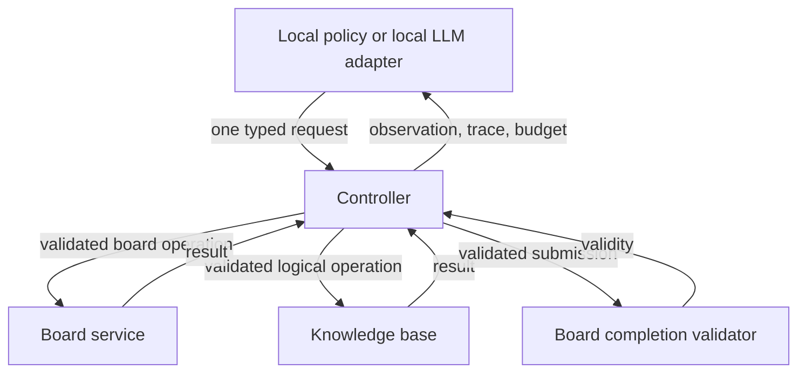

# Project component diagram (text alternative)

**Accessible text description:** A local policy or local language-model adapter proposes one typed request to the controller. The controller validates it, routes board operations to the board service and logic operations to the knowledge base, then records the resulting observation and action budget. A submission is checked by the board validator, and only the controller sets terminal status. The next decision uses the recorded observation and trace.
